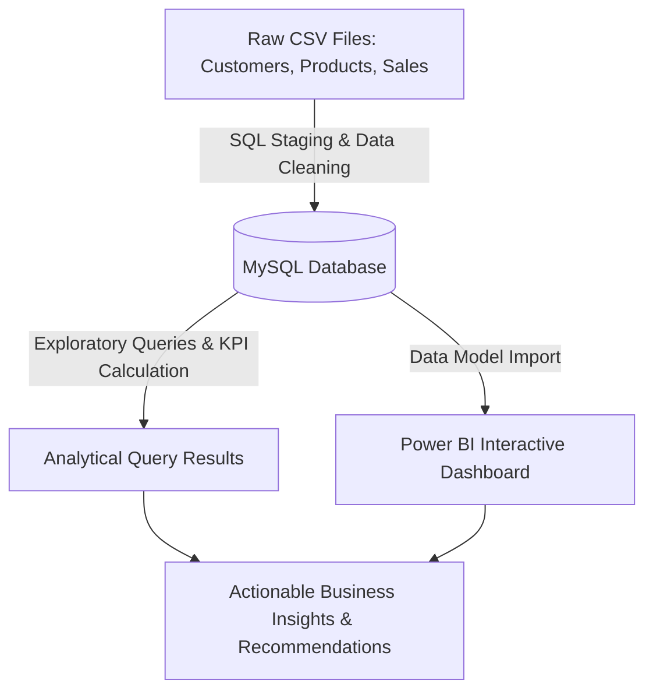

# 🛒 E-Commerce Sales & Customer Performance Analytics

[](https://www.mysql.com/)
[](https://powerbi.microsoft.com/)
[]()

## 📌 Project Overview & Business Problem
E-commerce retail organizations generate massive transactional datasets daily, but struggle to transform raw order logs into actionable commercial strategies. This project delivers an end-to-end data analytics solution for an Indian e-commerce retailer (tracking nationwide sales across multiple states). The objective is to evaluate revenue realization, dissect customer tier profitability, audit product category performance, and analyze fulfillment efficiency to drive data-backed operational improvements.

---

## 🎯 Project Objectives & Analytical Questions
1. **Revenue Realization**: What is the total gross potential revenue vs. realized revenue across different order lifecycle statuses (Delivered, Returned, Cancelled, Processing, Shipped)?
2. **Customer Segmentation**: How do customer tiers (Platinum, Gold, Silver) and age demographics contribute to total sales volume?
3. **Product & Discount Effectiveness**: Which product categories and brands generate the highest revenue, and how do discount brackets influence purchasing behavior?
4. **Logistics & Operations**: What is the geographic distribution of sales and order delivery speed?

---

## 🛠️ Tools & Technologies Used
*   **SQL (MySQL)**: Data ingestion (`LOAD DATA LOCAL INFILE`), type casting, date sanitization (`STR_TO_DATE`), handling missing values, window functions (`LAG`, `ROW_NUMBER`), and multi-table joins.
*   **Power BI**: Interactive business intelligence dashboard development, data modeling (star schema relationships), DAX measures, and KPI card formatting.
*   **Git & GitHub**: Version control and professional portfolio presentation.

---

## 📊 Dataset Description
The analysis utilizes three normalized CSV datasets:
*   **[customers.csv](./customers.csv) (40,000 rows)**: Customer demographics, registration dates, tiers (`Platinum`, `Gold`, `Silver`), and lifetime spend.
*   **[products.csv](./products.csv) (2,000 rows)**: Product catalog details, original prices, selling prices, discount percentages, stock quantities, and ratings.
*   **[sales.csv](./sales.csv) (250,000 rows)**: Transaction-level logs capturing order dates, delivery dates, quantities, unit prices, shipping costs, coupon details, payment modes, and order statuses.

---

## 🔄 Project Workflow


---

## 🧹 Data Cleaning & Preparation (SQL)
**[e_commerce_queries.sql](./e_commerce_queries.sql)**
```sql
-- DATA CLEANING AND PREPARATION
ALTER TABLE customers
MODIFY COLUMN Date_of_Birth DATE,
MODIFY COLUMN Registration_Date DATE;

UPDATE sales
SET Order_Date = STR_TO_DATE(Order_Date, "%m/%d/%Y");

UPDATE sales
SET Delivery_Date = STR_TO_DATE(Delivery_Date, "%m/%d/%Y");

ALTER TABLE sales
MODIFY COLUMN Order_Date DATE,
MODIFY COLUMN Delivery_Date DATE;

UPDATE sales
SET Rating = NULL 
WHERE Rating = '';

ALTER TABLE sales
MODIFY COLUMN Rating INT NULL;

-- UPDATING BLANK VALUES IN COLUMNS WITH FRIENDLY MESSAGE
UPDATE sales 
SET Coupon_Code = 'No coupon used' 
WHERE Coupon_Code IS NULL OR Coupon_Code = '';

UPDATE sales 
SET Review_Text = 'No written review left' 
WHERE Review_Text IS NULL OR Review_Text = '';
```

---

## 💻 SQL Analysis & Core Queries
**[e_commerce_queries.sql](./e_commerce_queries.sql)**
```sql
-- PART 1: OVERVIEW & MACRO KPIs

-- 1. High-Level Counts: Total Unique Orders, Active Customers (with Purchases), and Products Sold in Sales
SELECT 
	COUNT(DISTINCT Order_ID) AS total_unique_orders,
    COUNT(DISTINCT Customer_ID) AS total_unique_customers,
    COUNT(DISTINCT Product_ID) AS total_unique_products
FROM sales;


-- 2. Order Status Breakdown: Total Sales Value across all Order Lifecycle Stages
SELECT 
	SUM(CASE WHEN Order_Status = 'Delivered' THEN Total_Amount ELSE 0 END) AS total_sales,
    SUM(CASE WHEN Order_Status = 'Returned' THEN Total_Amount ELSE 0 END) AS refunded_sales,
    SUM(CASE WHEN Order_Status = 'Cancelled' THEN Total_Amount ELSE 0 END) AS lost_sales,
    SUM(CASE WHEN Order_Status = 'Processing' THEN Total_Amount ELSE 0 END) AS processing_sales,
    SUM(CASE WHEN Order_Status = 'Shipped' THEN Total_Amount ELSE 0 END) AS pending_sales,
    SUM(Total_Amount) AS gross_potential_sales
FROM sales;

-- PART 2: REALIZED REVENUE (Delivered Orders Only)

-- 1. Core Performance KPIs: Total Sales, Delivered Orders, and Average Order Value (AOV)
SELECT 
	SUM(Total_Amount) AS total_sales,
    COUNT(DISTINCT Order_ID) AS total_orders,
    SUM(Total_Amount) / COUNT(DISTINCT Order_ID) AS avg_order_value
FROM sales
WHERE Order_Status = 'Delivered';

-- 2. Sales Performance by Product Category (with percentage contribution)
SELECT
	p.Category,
    SUM(s.Total_Amount) AS total_sales,
	ROUND((SUM(s.Total_Amount) / (SELECT SUM(Total_Amount) FROM sales WHERE Order_Status = 'Delivered')) * 100, 2) AS sales_percentage
FROM sales AS s
INNER JOIN products AS p
	ON s.Product_ID = p.Product_ID
WHERE s.Order_Status = 'Delivered'
GROUP BY p.Category
ORDER BY total_sales DESC;

-- 3. Top 10 Best-Performing Brands by Sales Revenue
SELECT
	p.Brand,
    SUM(s.Total_Amount) AS total_sales
FROM sales AS s
INNER JOIN products AS p
	ON s.Product_ID = p.Product_ID
WHERE s.Order_Status = 'Delivered'
GROUP BY p.Brand
ORDER BY total_sales DESC
LIMIT 10;

-- 4. Monthly Revenue Trend and Month-over-Month (MoM) Growth Analysis
SELECT
	DATE_FORMAT(Order_Date, "%Y-%m") AS `year_month`,
    COUNT(Order_ID) AS total_orders,
    SUM(Total_Amount) AS monthly_sales,
    LAG(SUM(Total_Amount)) OVER(ORDER BY DATE_FORMAT(Order_Date, "%Y-%m")) AS previous_month_sales,
    SUM(Total_Amount) - LAG(SUM(Total_Amount)) OVER(ORDER BY DATE_FORMAT(Order_Date, "%Y-%m")) AS MoM_growth,
    ROUND((SUM(Total_Amount) - LAG(SUM(Total_Amount)) OVER(ORDER BY DATE_FORMAT(Order_Date, "%Y-%m"))) * 100 
    / LAG(SUM(Total_Amount)) OVER(ORDER BY DATE_FORMAT(Order_Date, "%Y-%m")),2) AS MoM_growth_pct
FROM sales
WHERE Order_Status = 'Delivered'
GROUP BY `year_month`
ORDER BY `year_month`;

-- 5. Geographic Performance: Top States by Sales Revenue and Unit Volume
SELECT
	State,
    COUNT(DISTINCT Order_ID) AS total_orders,
    SUM(Quantity) AS total_sold_units,
	SUM(Total_Amount) AS total_sales
FROM sales
WHERE Order_Status = 'Delivered'
GROUP BY State
ORDER BY total_sales DESC;

-- 6. Customer Segmentation: Revenue Contribution Share by Customer Tier
SELECT
	c.Customer_Tier,
    SUM(s.Total_Amount) AS total_sales,
    ROUND((SUM(s.Total_Amount)*100) / (SELECT SUM(Total_Amount) FROM sales WHERE Order_Status = 'Delivered'),2) AS sales_pct
FROM sales AS s
INNER JOIN customers AS c
	ON s.Customer_ID = c.Customer_ID
WHERE s.Order_Status = 'Delivered'
GROUP BY c.Customer_Tier
ORDER BY total_sales DESC;

-- 7. Customer Demographics: Sales Performance by Age Group
SELECT 
	Customer_Age_Group,
    COUNT(DISTINCT Order_ID) AS total_orders,
    SUM(Quantity) AS total_quantity_sold,
    SUM(Total_Amount) AS total_sales
FROM sales
WHERE Order_Status = 'Delivered'
GROUP BY Customer_Age_Group
ORDER BY total_sales DESC;

-- 8. Payment Preferences: Transaction Volume and Revenue Share by Payment Mode
SELECT
	Payment_Mode,
    COUNT(DISTINCT Order_ID) AS total_orders,
    SUM(Quantity) AS total_quantity_sold,
    SUM(Total_Amount) AS total_sales,
    ROUND((SUM(Total_Amount) * 100) / (SELECT SUM(Total_Amount) FROM sales WHERE Order_Status = 'Delivered'),2) AS sales_pct
FROM sales
WHERE Order_Status = 'Delivered'
GROUP BY Payment_Mode
ORDER BY total_sales DESC;

-- 9. Top 10 Customers by Realized Revenue
SELECT
    c.Customer_ID,
    c.Customer_Name,
    c.Customer_Tier,
    COUNT(DISTINCT s.Order_ID) AS total_orders,
    SUM(s.Total_Amount) AS total_sales
FROM sales AS s
INNER JOIN customers AS c
    ON s.Customer_ID = c.Customer_ID
WHERE s.Order_Status = 'Delivered'  
GROUP BY c.Customer_ID, c.Customer_Name, c.Customer_Tier
ORDER BY total_sales DESC
LIMIT 10;                               

-- PART 3: PRODUCT & INVENTORY INSIGHTS

-- 1. Top 10 Best-Selling Products (Ranked by Units Sold)
WITH cte AS
(
SELECT
	p.Product_ID,
    p.Product_Name,
    p.Stock_Quantity,
    SUM(s.Quantity) AS total_units_sold
FROM products AS p
INNER JOIN sales AS s
	ON p.Product_ID = s.Product_ID
WHERE s.Order_Status = 'Delivered'
GROUP BY p.Product_ID, p.Product_Name, p.Stock_Quantity
),
ranked_cte AS
(
SELECT 
	*,
    ROW_NUMBER() OVER(ORDER BY total_units_sold DESC) AS unit_rank
FROM cte
)
SELECT *
FROM ranked_cte
WHERE unit_rank <= 10
ORDER BY unit_rank ASC;

-- 2. Revenue & Total Units Sold by Discount Bracket
SELECT
	CASE 
		WHEN p.Discount_Percent BETWEEN 0 AND 10 THEN '0-10%'
        WHEN p.Discount_Percent BETWEEN 11 AND 25 THEN '11-25%'
        WHEN p.Discount_Percent BETWEEN 26 AND 50 THEN '26-50%'
	END AS discount_brackets,
	SUM(s.Total_Amount) AS total_sales,
	SUM(s.Quantity) AS total_units_sold
FROM products AS p
INNER JOIN sales AS s
	ON p.Product_ID = s.Product_ID
WHERE s.Order_Status = 'Delivered'
GROUP BY discount_brackets
ORDER BY total_sales DESC;


-- PART 4: OPERATIONS & LOGISTICS PERFORMANCE

-- 1. Supply Chain Audit: Total Delivered Orders by State
SELECT
    State,
    COUNT(DISTINCT Order_ID) AS total_orders_delivered
FROM sales
WHERE Order_Status = 'Delivered'
GROUP BY State
ORDER BY total_orders_delivered DESC;

-- 2. Total Orders by Delivery Speed Tiers
WITH delivery_days AS (
    SELECT
        Order_ID,
        DATEDIFF(Delivery_Date, Order_Date) AS days_delivered,
        Total_Amount
    FROM sales
    WHERE Order_Status = 'Delivered'
)
SELECT
    CASE 
        WHEN days_delivered <= 3 THEN 'Fast (1-3 Days)'
        WHEN days_delivered BETWEEN 4 AND 5 THEN 'Standard (4-5 Days)'
        ELSE 'Slow (6+ Days)'
    END AS delivery_speed_tier,
    COUNT(DISTINCT Order_ID) AS total_orders
FROM delivery_days
GROUP BY delivery_speed_tier;
```

---

## 📈 Power BI Dashboard Preview
**[e_commerce_data_analysis.pbix](./e_commerce_data_analysis.pbix)**

### Interactivity & Navigation
* **Left-Hand Navigation Pane:** Allows seamless switching between report pages (*Executive Overview*, *Customer & Revenue Insights*, and *Inventory & Fulfillment*).
* **Right-Side Filter Toggle:** Users can click the arrow button on the right edge to expand or collapse the **Slicer Panel**, enabling dynamic filtering by year, order status, category, state, and payment mode without cluttering the main view.


---

## 🔍 Key Findings & Insights

This Power BI reporting solution provides an end-to-end executive view of an e-commerce platform's financial performance, customer segmentation, and fulfillment efficiency. While the platform commands a Gross Potential Revenue of ₹5.93 billion, the core metrics are filtered to Order Status = Delivered to isolate the Realized Revenue at ₹4.74 billion (across 200K orders and 40K customers)—stripping out fulfillment friction and leakage to reflect actual cash-in-hand business performance.

### 1. Executive Performance & Revenue Health
* **Strong Core Revenue with High Leakage Risks**: The platform generated ₹4.74bn in Realized Revenue with an impressive Average Order Value (AOV) of ₹23,690. However, non-realized revenue status summary reveals substantial friction: ₹587M in Pending, ₹300M in Refunded, and ₹302M in Lost revenue (totaling ~₹1.19bn in uncaptured or reversed value).

### 2. Category Concentration & Brand Dominance
* **Electronics Monopoly**: Electronics is the runaway category leader, driving ₹3.44bn (72.62%) of total revenue. Home goods follow distantly at ₹0.57bn (12.09%), while Sports, Fashion, Grocery, Beauty, and Books make up the remaining tail.

* **Top Brands Drive the Catalog**: The top 5 brands—HP (₹0.75bn), Noise (₹0.73bn), boAt (₹0.67bn), Samsung (₹0.67bn), and Apple (₹0.62bn)—account for the lion's share of brand-specific earnings, showing heavy reliance on top-tier consumer tech and audio brands.

### 3. Customer Tier Behavior & Payment Preferences
* **Platinum Tier Dominance**: The Platinum customer tier generates the vast majority of revenue, heavily outperforming Gold and Silver tiers.

* **Payment Modalities**: Across high-tier customers, traditional and digital hybrid payment methods—particularly Cash on Delivery (COD) and digital channels (Credit/Debit cards and UPI)—play a critical role in high-value basket sizes.

### 4. Inventory, Discounts, and Fulfillment Dynamics
* **Evenly Distributed Delivery Speeds**: Fulfillment tiers are split almost equally into thirds: Fast (1–3 days) at 33.46%, Standard (4–5 days) at 33.39%, and Slow (6+ days) at 33.16%, indicating an operational bottleneck where a third of orders still face delayed transit times.

* **Discount Sensitivity**: The 26%–50% discount bracket is the primary revenue driver, generating ₹2.3bn across 138K units sold. In contrast, low discounts (0–10%) yield only ₹0.8bn (33K units), proving that volume heavily relies on aggressive markdown strategies.

* **Geographic Hotspots**: Order volume is heavily concentrated in northern and western hubs, led by Uttar Pradesh (26.1K orders), Haryana (25.7K orders), and Rajasthan (25.4K orders).

## 💡 Strategic Business Recommendations
* **Mitigate Revenue Leakage**: Address the ₹587M in Pending and ₹302M in Lost revenue by optimizing checkout verification, reducing payment gateway drop-offs, and implementing proactive customer communication for stalled orders.

* **Optimize High-Value Fulfillment**: Since a full 33.16% of deliveries take 6+ days, logistics teams must streamline warehousing in key demand zones (UP, Haryana, Rajasthan) to shift slow shipments into faster tiers and minimize customer churn or refund requests.

* **Re-evaluate Discount Margins**: While the 26–50% discount bracket drives top-line growth (₹2.3bn), heavy discounting compresses profit margins. Introduce targeted cross-selling or loyalty perks for Platinum members to reduce reliance on steep markdowns.

* **Diversify Category Growth**: With Electronics capturing nearly 73% of revenue, cross-promote high-margin accessories in underperforming categories (such as Home and Fashion) to build a more resilient revenue mix.


